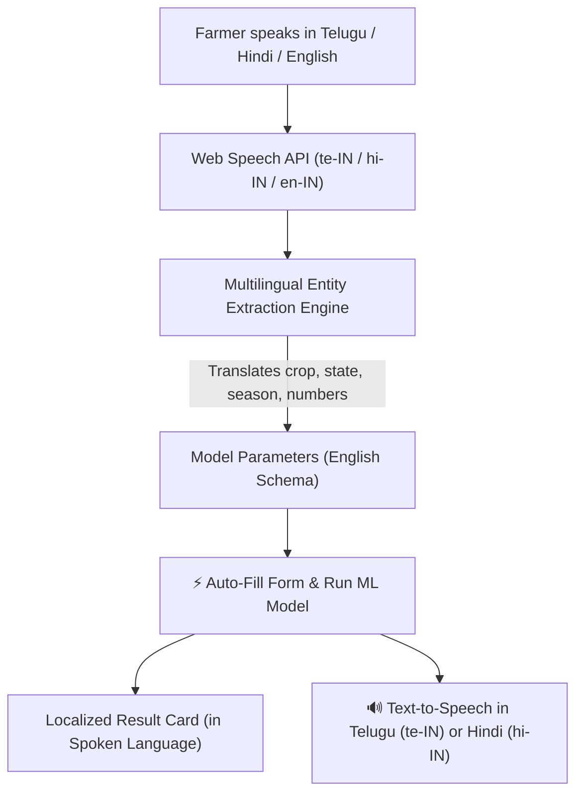

# CropZen — AI-Powered Precision Agriculture and Crop Yield Optimization System

Live Deployment: [https://cropzen.streamlit.app/](https://cropzen.streamlit.app/)  
GitHub Repository: [https://github.com/Hithesh-07/precision-agriculture-ml](https://github.com/Hithesh-07/precision-agriculture-ml)

An end-to-end Machine Learning web application designed to analyze historical agricultural records across Indian states, train multiple regression models, and estimate crop yields per hectare based on regional, meteorological, and farming inputs.

---

## 📌 Problem Statement & Scope

Crop yield prediction is inherently challenging because agricultural production varies widely with environmental conditions, crop characteristics, and regional differences. The reliability of machine-learning predictions depends on data quality, feature selection, and model performance.

This project implements a web-based system that:
1. Preprocesses historical Indian agricultural data (1997–2020) across 55 crops and 36 states/UTs.
2. Trains and compares **Linear Regression**, **Decision Tree Regressor**, and **Random Forest Regressor** pipelines.
3. Evaluates predictions on a held-out test split using standard regression metrics (**MAE**, **RMSE**, **R²**).
4. Provides interactive single-record predictions and batch CSV predictions.
5. Features full **trilingual English, Hindi (हिन्दी), and Telugu (తెలుగు) interface** support.
6. Implements **multilingual voice interaction**: farmers can speak in Telugu, Hindi, or English; CropZen extracts parameters into model features and speaks back the answer in the user's native language.
7. Explains model behaviour via feature importance without asserting false causality.

> **Disclaimer:** This application is an educational prediction and analysis prototype developed for a 5th-semester CSE Design Project. It is **not** a certified farming advisory system and predictions should not be considered guaranteed outcomes.

---

## 📊 Multi-Dataset Architecture & Data Audit Findings

CropZen manages **four verified datasets** under strict data governance:

| Dataset | File | Rows | Geographic Level | Timeframe | Role & Governance |
| :--- | :--- | :--- | :--- | :--- | :--- |
| **Model-Ready (Curated)** | `data/cropzen_model_ready_2000_2020.csv` | 17,983 | State | 2000 – 2020 | **Candidate Training Dataset** (Complete features; evaluated on held-out test split) |
| **Original Baseline** | `data/crop_yield.csv` | 19,689 | State | 1997 – 2020 | **Historical Benchmark** (Includes 1997–1999 baseline records) |
| **District-Level** | `data/cropzen_india_district_2000_2020.csv` | 311,488 | District (706) | 2000 – 2020 | **Geospatial EDA Only** (Missing rainfall, fertilizer, pesticide — excluded from training) |
| **Official All-India** | `data/cropzen_india_official_all_india_2021_2025.csv` | 225 | National Aggregate | 2020-21 to 2024-25 | **Official Reporting Only** (Observed Yield missing — supervised validation prohibited) |
| **Combined Asset** | `data/cropzen_india_combined_2000_2025.csv` | 311,713 | Mixed | 2000 – 2025 | **Cross-Source Registry** (Requires grouping by geography_level) |

### Data Leakage Resolution
- **Investigation:** In raw agricultural statistics, `Production` represents the aggregate volume harvested. In our data leakage audit, `Yield` matches `Production / Area` in only 21.4% of rows on state-level data and 97.2% on district data.
- **Leakage Prevention Decision:** Since `Production` is an outcome measured post-harvest, including it would cause severe target leakage or trivial identity fitting. Therefore, **`Production` is strictly excluded from input features**.
- **Model Features (8):**
  - *Categorical:* `Crop`, `Season`, `State`
  - *Numerical:* `Crop_Year`, `Area` (ha), `Annual_Rainfall` (mm), `Fertilizer` (kg), `Pesticide` (kg)
- **Target Variable:** `Yield` (log1p transformed during training due to extreme right skewness, max 21,105 vs median 1.03; inverse `expm1` applied to output predictions).

---

## 🧠 Model Training & Evaluation Results

All models were evaluated on the **held-out 20% test split** with `random_state=42`. Preprocessing is embedded inside scikit-learn `Pipeline` objects using `ColumnTransformer` (OrdinalEncoder for categorical variables handling unseen values, StandardScaler for numeric variables).

### Results on Curated Model-Ready Dataset (2000–2020)
| Model | MAE (tonnes/ha) | RMSE (tonnes/ha) | R² Score | Status |
| :--- | :---: | :---: | :---: | :---: |
| **Linear Regression** | 68.7350 | 842.1751 | -0.0059 | Baseline |
| **Decision Tree Regressor** | **7.9144** | **121.4133** | **0.9791** | ⭐ **Selected Best Model** |
| **Random Forest Regressor** | 12.1997 | 190.0501 | 0.9488 | Ensemble Candidate |

### Chronological Out-of-Sample Evaluation (Time-Based Split: Train ≤2015, Test >2015)
- **Decision Tree Regressor:** MAE = 8.60 t/ha, RMSE = 107.92 t/ha, R² = 0.9839
- Demonstrates strong out-of-time stability across unseen subsequent agricultural seasons.

*Note: R² measures the proportion of variance explained by the model (upper bounded by 1.0). It is not classification accuracy. MAE and RMSE are expressed in tonnes per hectare.*

---

## 🌐 Multilingual Voice Interaction & Trilingual Support

CropZen is specifically tailored for Indian agricultural diversity with seamless multilingual voice and text capabilities:



### 1. Trilingual User Interface
- Full interface localization available via the top-right header selector:
  - 🇬🇧 **English**
  - 🇮🇳 **हिन्दी (Hindi)**
  - 🇮🇳 **తెలుగు (Telugu)**
- Translations are managed in `src/translations.py` with 100% key parity across all pages, metrics, forms, and alerts.

### 2. Speech-to-Text with Regional Language Recognition
- Built using the browser Web Speech API (`SpeechRecognition` / `webkitSpeechRecognition`).
- Language selector inside the voice box allows farmers to select:
  - 🇮🇳 **తెలుగు (`te-IN`)**
  - 🇮🇳 **हिन्दी (`hi-IN`)**
  - 🇬🇧 **English (`en-IN`)**
- Continuous transcription with live interim feedback, recording indicator, and fallback error diagnostics for microphone permissions.

### 3. Natural Language Entity Extraction & Indian Numeral Normalization
- Extracts crops, states, seasons, areas, rainfall, and years from spoken Telugu, Hindi, or English:
  - **Telugu Example:** *"వరి ఆంధ్రప్రదేశ్ ఖరీఫ్ విస్తీర్ణం 5000 వర్షపాతం 1200"*  
    &rarr; Extracts: `Crop: Rice`, `State: Andhra Pradesh`, `Season: Kharif`, `Area: 5,000 ha`, `Rainfall: 1,200 mm`
  - **Hindi Example:** *"गेहूं पंजाब रबी 4000 हेक्टेयर 800 वर्षा"*  
    &rarr; Extracts: `Crop: Wheat`, `State: Punjab`, `Season: Rabi`, `Area: 4,000 ha`, `Rainfall: 800 mm`
  - **English Example:** *"Cotton Maharashtra Kharif 2500 hectares 950 rainfall"*  
    &rarr; Extracts: `Crop: Cotton(lint)`, `State: Maharashtra`, `Season: Kharif`, `Area: 2,500 ha`, `Rainfall: 950 mm`
- Automatically normalizes Telugu numerals (`౦-౯`) and Devanagari numerals (`०-९`) to standard digits (`0-9`).

### 4. One-Click Form Auto-Fill
- An **"⚡ Auto-Fill Form"** button transfers all recognized parameters directly into the Streamlit input form.

### 5. Localized Answer in the Spoken Language
- CropZen remembers the language the user spoke and delivers the prediction result in that exact language:
  - **Visual Result Card:** Shows a highlighted localized card with crop name, predicted yield per hectare, and estimated total production in Telugu or Hindi.
  - **Audio Readout (Text-to-Speech):** Clicking **🔊 Listen / వినండి / सुनें** reads out the prediction fluently in Telugu (`te-IN`), Hindi (`hi-IN`), or English (`en-IN`) using browser speech synthesis.

---

## ⚙️ Setup and Installation (Windows / PowerShell)

### 1. Prerequisites
- Windows 10/11 or Linux / macOS
- Python 3.10+ (tested on Python 3.13 and Python 3.15)

### 2. Virtual Environment Setup
Open PowerShell in the project directory:
```powershell
cd "c:\Users\98858\OneDrive\Documents\5th Sem\DESIGN PROJECT\precision-agriculture-ml"

# Create virtual environment if not already created
python -m venv .venv

# Bootstrap pip if needed
.venv\Scripts\python.exe -m ensurepip --upgrade

# Install required dependencies
.venv\Scripts\python.exe -m pip install -r requirements.txt
```

---

## 🚀 Execution Commands

### 1. Run Comprehensive Data Audit
To inspect data quality, verify schema integrity, check leakage, and audit all datasets:
```powershell
.venv\Scripts\python.exe data_audit.py
```
Outputs audit statistics, writes markdown report to `reports/data_audit.md`, and saves `outputs/audit_summary.json`.

### 2. Train / Retrain Machine Learning Models
Train on the curated model-ready dataset:
```powershell
.venv\Scripts\python.exe train_model.py --dataset model_ready
```
Or train with a chronological time-based split:
```powershell
.venv\Scripts\python.exe train_model.py --dataset model_ready --split time --split-year 2015
```
Saves:
- `models/best_model.pkl`: Serialized model pipeline
- `outputs/feature_schema.json`: Categories, numeric bounds, and validation rules
- `outputs/evaluation.json`: Test metrics, split metadata, and test residuals

### 3. Run Automated Tests
```powershell
.venv\Scripts\python.exe -m pytest tests/ -v
```
*(63 unit and integration tests passing, covering data loading, schema validation, model inference, translations parity, Telugu/Hindi voice parsing, numeral normalization, and batch validation).*

### 4. Launch the Web Application
```powershell
.venv\Scripts\python.exe -m streamlit run app.py
```
The application will launch and open in your default browser at `http://localhost:8501`.

---

## 🛡️ Security & Reliability Controls

1. **Retraining Guard:** The web application disables arbitrary public retraining to prevent resource exhaustion and denial-of-service. Retraining is executed explicitly via `train_model.py`.
2. **Safe Model Deserialization:** The app loads models strictly from project-controlled paths (`models/best_model.pkl`), never from user uploads.
3. **Batch File Validation:** Uploaded CSVs are subject to a 5 MB file size limit, 5,000-row batch limit, strict column validation, and data type sanitization.
4. **Sandboxed Voice Execution:** Web Speech API runs safely in the client browser. No audio is transmitted to or stored on the application server.
5. **Session Privacy:** Prediction history is transiently stored in Streamlit `session_state` and never persisted to external databases.

---

## 📁 Project Architecture

```
precision-agriculture-ml/
├── app.py                         # Main Streamlit web application & UI shell
├── train_model.py                 # Reproducible training & model comparison pipeline
├── data_audit.py                  # Exploratory data audit & leakage verification
├── requirements.txt               # Verified Python package dependencies
├── README.md                      # Comprehensive project documentation
├── .gitignore                     # Artifact & environment exclusions
├── data/
│   ├── cropzen_model_ready_2000_2020.csv  # Curated training dataset (17,983 rows)
│   ├── crop_yield.csv                     # Historical benchmark dataset (19,689 rows)
│   ├── cropzen_india_district_2000_2020.csv # District-level EDA dataset (311k rows)
│   ├── cropzen_india_official_all_india_2021_2025.csv # Official national data
│   └── cropzen_india_combined_2000_2025.csv # Combined multi-geography dataset
├── models/
│   └── best_model.pkl             # Serialized production pipeline (Decision Tree Regressor)
├── outputs/
│   ├── audit_summary.json         # Data audit summary
│   ├── evaluation.json            # Test evaluation metrics & residuals
│   └── feature_schema.json        # Validated category maps & feature ranges
├── reports/
│   └── data_audit.md              # Detailed data audit and integrity report
├── src/
│   ├── __init__.py
│   ├── data_processing.py         # Data cleaning, schema validation & ColumnTransformer
│   ├── model_training.py          # Model training logic, log1p transformation & evaluation
│   ├── multilingual_voice.py      # Telugu/Hindi/English speech parser, entity extractor & TTS
│   ├── prediction.py              # Single-record & batch CSV inference engine
│   ├── translations.py            # Centralized English, Hindi & Telugu translations
│   └── voice_utils.py             # Browser Web Speech API HTML/JS components
└── tests/
    ├── __init__.py
    ├── test_pipeline.py           # Core pipeline, model, and dataset integrity tests (47 tests)
    └── test_multilingual_voice.py # Multilingual parsing, Telugu/Hindi TTS & translation tests (16 tests)
```

---

## ☁️ Deployment Instructions (Streamlit Community Cloud)

1. Push this repository to GitHub (`models/best_model.pkl` and `outputs/` are committed).
2. Go to [share.streamlit.io](https://share.streamlit.io).
3. Connect your GitHub repository: `Hithesh-07/precision-agriculture-ml`.
4. Set Main file path to `app.py`.
5. Deploy. The application automatically builds and runs with full trilingual and voice capabilities enabled.
